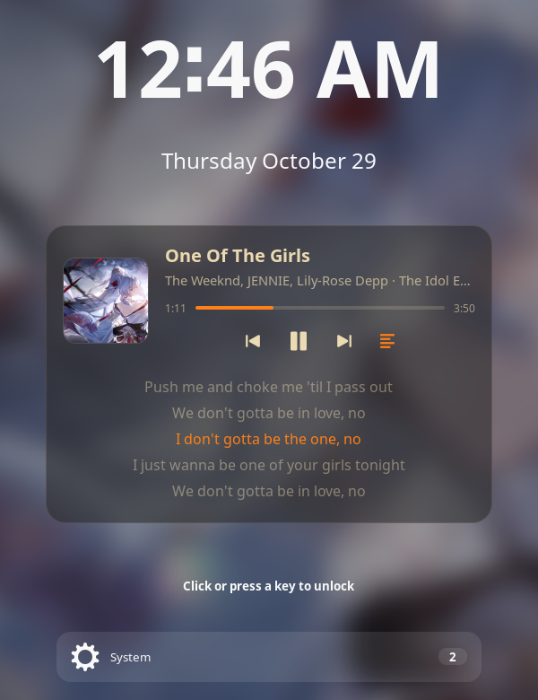

# Lockplayer



A now-playing card for the GNOME lock screen, inspired by the macOS lock
screen media player. It sits under the clock while music plays and steps aside
with the clock when you start typing your password.

## Features

- Album art, title, artist and album.
- A live progress bar with elapsed and total time.
- Previous, play/pause and next buttons. They only control playback, so they
  can't get around the lock.
- Synced lyrics from [LRCLIB](https://lrclib.net) that scroll with the song,
  current line highlighted. Plain lyrics are used when no synced version
  exists. Results are cached in `~/.cache/lockplayer`, including misses, so each
  song is looked up once.
- Click the cover for large album art. The lyrics button shows or hides lyrics.
- Notifications move up under the clock and card instead of sitting at the
  bottom of the screen, and GNOME's own media card is hidden from them since
  the now-playing card replaces it (both can be turned off).
- Works with any MPRIS player (Spotube, Firefox, Spotify, …). It talks to
  players over D-Bus directly instead of through GNOME's media list, so
  extensions that hide GNOME's media notification don't affect it.
- Players that report no track length (Spotube does this) get it from the
  lyrics lookup.

## Requirements

- GNOME Shell 50.

## Install from source

```sh
make install
```

Then log out and back in, and enable **Lockplayer** in the Extensions app.
It runs in the `unlock-dialog` session mode, so it stays active while locked.

## Build a zip

```sh
make pack
```

## License

GPL-2.0-or-later.
